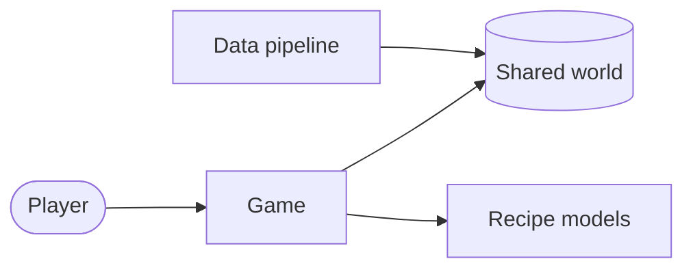

# ARCHITECTURE.md template

Concepts first, code second. Omit any section that would be empty. Keep the whole file under ~120 lines. When writing in another language, translate the headings and labels too.

````markdown
# Architecture

Updated: <YYYY-MM-DD> · <short commit>

## Overview
<2–3 short paragraphs a developer new to the repo can read on their own: what the system does and for whom, the big parts and how they work together, and the main tech choices. Use the parts' human names. No file paths, table names, or function names.>

## Big picture

<≤ 8 boxes, human names only, the same names as the Parts table.>

## Parts
| Part | What it does | Code |
|---|---|---|
| <Human name> | <one plain sentence> | `path/` · [doc](<existing area doc, if any>) |

## Key flows
### <Flow name, in plain words>
1. <Step in plain words, naming parts, not files.>
2. <3–7 steps in total.>

Code: `path/to/main_file`, `path/to/other_file`

<Add one small diagram (≤ 8 nodes or messages, human names) only if the flow branches or has many actors. At most two diagrams outside the big picture in the whole doc.>

## Data model
<2–4 sentences on the main concepts and how they relate, in plain words. A small `erDiagram` (≤ 6 entities) only if prose can't carry it, counted in the two-diagram limit. Link the migrations or schema for the rest.>

## Decisions
- [ADR-0001: <title>](adr/0001-<slug>.md)

## Sharp edges
- <Non-obvious behaviour, coupling, or constraint a newcomer would trip on, in plain words, then the `path`.>
````
