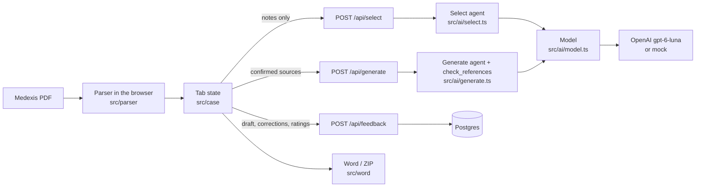

# Architecture

Living document: it describes the code as it is. Decisions are in `docs/adr/`, the implementation reference is `docs/master-doc.md`, terms are in `GLOSSARY.md`.

## Shape

One Next.js 16 app (App Router, TypeScript, Tailwind, shadcn/ui on Base UI) with its API in route handlers. Postgres through Drizzle (Docker locally, Neon in production). Better Auth inside the app. The AI layer is the Vercel AI SDK calling OpenAI directly. PDF parsing, editing and downloads happen in the browser; the server never sees the file, the header or a file name.

## Modules

| Area | Where | Notes |
| --- | --- | --- |
| Contracts | `src/contracts/` | Zod schemas shared by browser and server: case (header, notes, states), ai (select and generate bodies), draft (sections, references, alerts), feedback, telemetry. Structured-output schemas use required nullable fields, never defaults. |
| Parser | `src/parser/` | `pdf.ts` extracts positioned text through PDF.js (`pdf-browser.ts` in a worker, `pdf-node.ts` for scripts and tests); `lines.ts` groups segments into lines; `medexis.ts` reconstructs the header and notes; `specialties.ts` is the versioned label catalog. Image-only pages are ignored; a PDF with no text is rejected. |
| Tab state | `src/case/` | `reducer.ts` is the case state machine (states, revision, attempt ids, edits, ratings, feedback status, batch cap); `runner.ts` is the case runner: the attempt lifecycle of both clinical steps, the source projection, the batch step and feedback sync, driven through a transport (HTTP in the browser, in-process in the scripts) and emitting reducer actions; `store.tsx` is the React adapter: plain reducer, idle timer, batch queue (`queue.ts`) and the effect that sends feedback whenever a reviewed case is stale. Pure helpers beside it: `insurer.ts` proposes the insurer from the coverage text (else the last one chosen), `pending.ts` summarises what a draft still lacks before confirmation, `summary.ts` computes the ZIP partition, what finishing would lose and the next pending case. Nothing clinical touches browser storage. |
| Workspace UI | `src/components/workspace/` | The queue of cases at the left (`case-rail`, `case-list`, `batch-bar`) and one stage per case at the right (`case-detail`; stage logic in `src/case/stage.ts`, [ADR-0006](adr/0006-one-stage-per-case.md)): `header-form` (Datos), `sources-step` with `sources-panel` (Fuentes, read-only once a draft exists), `draft-step` with `draft-editor` and its sources side panel (Revisar), `copy-step` (Copiar, only once reviewed). `upload-zone` holds the one file input and the drop target of the whole workspace; `step-actions` is the bottom bar. |
| AI | `src/ai/` | `modules.ts` composes `prompts/` (core, task, insurer/pami, insurer/<name>) and records versions; `model.ts` builds the provider once; `mock.ts` is the deterministic model for tests; `select.ts` and `generate.ts` are the runs; `errors.ts` maps failures to categories and safe HTTP errors; `run-case.ts` drives the case runner with an in-process transport for the scripts. |
| API | `src/app/api/` | `select`, `generate` (auth, size and input limits, no-store, technical events, 150 s function cap), `feedback`, `admin/users`, `account/password`, `auth/[...all]`. `src/lib/http.ts` wraps handlers; `src/lib/session.ts` authorizes. |
| Persistence | `src/db/` | `auth-schema.ts` (generated by Better Auth), `feedback-schema.ts` (`rhc_case`, `rating`, `edit_event`, `technical_event`), migrations in `drizzle/`. No table holds identifiers, header fields, notes or file names (ADR-0003). |
| Downloads | `src/word/` | `rhc-docx.ts` builds the PAMI-format Word document with the logo in the page header (`logo.ts` fetches `/logo-blue.png`); `rhc-zip.ts` packs reviewed cases with `excluidos.txt`. Both load on demand, not with the page. |
| Limits | `src/lib/limits.ts`, `src/lib/env.ts` | Operational limits from env with master-document defaults; server-only env validated at startup. |

## Case flow

1. The browser parses the PDF and shows the header; the reviewer corrects it, picks the insurer and confirms. Any header change advances the revision.
2. `POST /api/select` receives the notes and answers the proposed sources per specialty with flags; the reviewer adjusts them in the sources panel. Changing sources or the insurer discards the draft.
3. `POST /api/generate` receives the confirmed selection and only the notes it uses. The agent cites every statement, verifies citations with `check_references`, and the server re-validates: dangling references and unsupported quantities become alerts.
4. The reviewer edits by section and field (edits tracked by kind with an optional reason), confirms "Revisé el contenido", then copies fields or downloads Word. The confirmation sends the generated and corrected drafts, ratings and edit events under the random case token; a storage failure only shows a notice.
5. Batch: every confirmed case is processed with the proposed sources, two at a time; failed cases can be retried; the ZIP holds reviewed documents only.

Each clinical call has an attempt id; the reducer applies a response only to the attempt still open, so cancelled or superseded responses are discarded. The browser performs one retry after a transient failure. After 30 minutes idle (5-minute warning) the tab locks and cancels the calls in flight and the rest of a batch: the cases stay in the provider's state with the workspace unmounted (no case text in the page), until the user re-enters the password (verified with a Better Auth sign-in) or chooses "Cerrar y borrar", which clears the tab and signs out. A 401 from any app endpoint (the login session ended, also when the account was disabled) clears the tab and lands on sign-in with the reason. The Better Auth HTTP route answers only sign-in, sign-out and get-session; admin operations run server-side through `auth.api` from the app's own routes.

## Verification

`pnpm verify` runs typecheck, lint, Vitest (unit, and integration against the `sienes_test` database) and Playwright on the synthetic fixtures with the mock model. `pnpm ai:smoke` and `pnpm ai:real` exercise the real model outside the automated loop.
