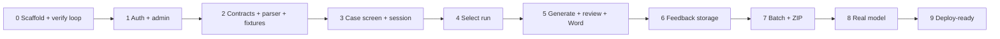

# Application v1 build

Status: building · Updated: 2026-11-06

## Problem
The functional scope, stack and agent design are decided (master document, ADR-0001 to ADR-0004, [RHC generation agent](rhc-generation-agent.md)) but no code exists. This plan orders the whole first version into vertical slices that can each be built, verified locally and committed, ending in an app that is ready to deploy but not deployed.

## Solution
One Next.js app at the repository root, developed against Postgres in Docker, verified by a single `pnpm verify` command after every slice, and exercised with `gpt-6-luna` on synthetic fixtures and, within a small budget, on the real exports held locally. Each slice ends with a commit and a green verify run; the next slice does not start before that.

## Decisions
- Local development: Postgres 17 in `docker-compose.yml`; Next.js runs natively with `pnpm dev`. Neon is used only for preview and production, created later under the info@qwesoftware.com account (ADR-0002).
- Authentication: Better Auth inside the app, email and password, closed sign-up, Admin plugin, seed script for the first administrator, temporary passwords instead of email reset (ADR-0004).
- PDF reading: `pdfjs-dist` in a browser Web Worker; the file never reaches the server.
- Model: `gpt-6-luna` through `@ai-sdk/openai` (Responses API) with `store: false`, SDK retries off, 120 s per attempt, Zod structured output for Select and Generate, reasoning effort from configuration (default medium). The AI SDK mock model drives every automated test; a manual script runs the real model.
- Real exports: may be run through the app locally during development, with the OpenAI key in `.env.dev`, up to about 3 USD. Nothing from them enters the repository, fixtures, logs or chat; drafts generated from them are kept only in the local Docker database under ADR-0003 rules.
- Brand: Work Sans via `next/font`; primary blue `#1200B8`; magenta `#FF00AC` only for each step's main action; pill buttons; white surfaces, gray `#676767` text; wordmark until a logo file is supplied in `public/`.
- Layout: app at the root; `prompts/` for prompt modules (`core.md`, `insurer/<name>.md`, PAMI as the general module); `fixtures/` for synthetic cases; `scripts/` for seed, fixture generation and the real-model smoke run.
- Verify loop: `pnpm verify` runs typecheck, lint, Vitest (unit and integration against the Docker database) and Playwright end-to-end on the fixtures with the mock model. A pre-commit hook runs typecheck and lint; the full loop runs before each commit that closes a slice.
- Versions pinned at scaffold: Next 16.4, React 19.3, AI SDK 7, `@ai-sdk/openai` 4, Better Auth 1.7, Drizzle 0.45, Zod 4, `pdfjs-dist` 6, `docx` 9, JSZip 3, Vitest 5, Playwright 1.65, Tailwind 4, shadcn 4. Lockfile committed; no `latest` tags.
- Deployment: prepared (`vercel.json` with `gru1`, env var list, migration command, runbook) but not executed until the owner says so.

## Rejected
- Whole app in Docker: Vercel does not run containers, so there is no parity gain and the loop is slower.
- Neon Auth for local work: needs a Neon project for every developer run (ADR-0004).
- Server-side PDF parsing: uploads the binary, subject to the 4.5 MB function body cap, and holds patient data in server memory.
- Real model inside the automated verify loop: cost on every iteration and non-deterministic assertions.

## Diagram

## Slices
1. [x] **Scaffold and verify loop**: Next.js app, TypeScript strict, Tailwind, shadcn/ui, brand theme and base layout, pnpm, `docker-compose.yml` (Postgres 17), Drizzle with first migration, typed config module from env validated at startup (limits from the master document), `pnpm verify`, pre-commit hooks, stack skills installed, `.env.example`. Verify: `pnpm verify` green on the empty app; Playwright opens the home page and sees the wordmark in Work Sans.
2. [x] **Auth and administration**: Better Auth with Admin plugin, sign-in page, seed script for the first admin, must-change-password flow, user list with create/disable/reset, last-admin guard, authorization helper used by every route. Verify: Vitest proves sign-up is rejected and a disabled user's session fails on the next request; Playwright signs in, creates a user, disables it and sees it locked out.
3. [x] **Contracts, parser and fixtures**: Zod contracts (sources, results, telemetry, API bodies), specialty alias catalog, `pdfjs-dist` worker, Medexis parser (header, notes with recorded date, author, specialty, pages, image-only pages ignored, no-text PDF rejected), fixture generator producing three synthetic exports (mislabeled notes, interdisciplinary note, undated note, one image-only page, one no-text file), read-only local script that parses the real exports and prints counts only. Verify: Vitest parser tests on the fixtures; the local script parses all 13 real exports without error.
4. [x] **Case screen and clinical session**: upload, header confirmation, insurer selection, case state machine (reading, confirmation required, analyzing, ready to generate, generating, draft, reviewed, error, canceled), revision and attempt ids, 30-minute idle timer with 5-minute warning and clear-on-expire, leave warning. Verify: Playwright uploads a fixture and confirms the header; a fake-clock unit test expires the session and clears state.
5. [x] **Select run**: prompt module loader with versions, Select agent on the mock model, route handler with auth, limits, `Cache-Control: no-store`, sources screen per specialty with flags and label overrides, editable by the reviewer. Verify: unit tests for module selection and version recording; Playwright confirms adjusted sources; a unit test asserts a label override is flagged.
6. [x] **Generate, review and Word**: Generate agent with `check_references`, app-side reference and number validation, draft by section with references panel, alerts, CIE-10 and prestación fields, edit tracking by field with optional reason, regeneration warning, review confirmation bound to the revision, per-field copy with character count, Word download via `docx`. Verify: dangling reference becomes an alert; copy and download stay disabled until confirmation and are disabled again after an edit; Vitest reads the generated `.docx` and finds every section.
7. [x] **Feedback storage**: tables for RHC cases, ratings, edit events and technical events; written on review confirmation under a random case id; failure never blocks download. Verify: integration test proves the stored row has no header field and no file name; a simulated storage failure still allows download and shows a notice.
8. [ ] **Batch**: multi-file queue in tab memory, concurrency 2, per-case states, retry only failed cases, cancel in flight, ZIP of reviewed cases only with excluded cases listed. Verify: Playwright runs three fixtures with one forced failure and downloads a ZIP with two documents.
9. [ ] **Real model**: `gpt-6-luna` adapter with timeout, browser-driven single retry, cancellation, telemetry with model and module versions; `pnpm ai:smoke` on a synthetic fixture; then real exports through the app locally, reporting tokens, cost and latency per case and stopping at the budget. Verify: late-response test; smoke output passes the result schema; cost per case measured and recorded in the spec.
10. [ ] **Deploy-ready**: `vercel.json` (`gru1`, no body logging), env var list, `pnpm db:migrate` for Neon, README runbook (`Verified:` date), `docs/ARCHITECTURE.md`, spec statuses updated. Verify: `pnpm build` succeeds; README commands run from a clean clone.

## Out of scope
- Deployment, Neon and Vercel project creation, email sending, OCR, insurer-specific forms, Medexis integration, portal automation.

## Open questions
- `gpt-6-luna` price per token is unknown; the first real run measures it and the budget check uses the measured value.
- Logo file: pending from the owner; wordmark until then.
- Sienes written confirmation of pseudonymous text storage before the pilot (ADR-0003).
