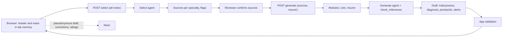

# RHC generation agent

Status: building · Updated: 2026-11-06

## Problem
Sienes staff write each PAMI renewal by hand: they read about two months of Medexis history, find the latest meaningful entry per specialty, and type the "Indicaciones" text plus the diagnosis and prestación fields into the portal. Notes are often mislabeled, so the content, not the type or author label, says what a note is. The app must produce a faithful draft with references, never inventing, and its rules must be easy to change after the pilot.

## Solution
Two agent runs per case on the Vercel AI SDK agent loop. **Select** reads every note in the export and returns, per specialty, the entry that best describes current status plus supporting notes for diagnosis, history and medication, with ambiguity flags; the reviewer confirms or adjusts the list. **Generate** writes the PAMI-format output from the confirmed sources: Indicaciones text by area, documented CIE-10 diagnosis, documented prestación (practice, module, quantity), and alerts; member data comes from the header in the browser. Its one tool, `check_references`, verifies every citation against the sources it was given; the app re-validates references and numbers after the call. The output is one downloadable document and the same content copyable field by field.

## Decisions
- Vercel AI SDK `ToolLoopAgent` with provider instances, SDK retries off, `abortSignal` cancellation, no bare-string model ids (ADR-0001).
- The model selects the sources by content; type and author-specialty labels are hints only, and every override of a label is flagged to the reviewer.
- Everything exported is used; there is no cutoff date and no date window. The app shows the export's date range so the reviewer can see what was included.
- Renewals only, PAMI format for every insurer. Inputs are the PDF and the insurer.
- Image-only pages are ignored without an alert; a PDF with no text layer is rejected with instructions to export again.
- Prompt modules: `core` + `insurer/<name>`; PAMI is the general module. Module versions are recorded with the model id.
- Only tool in v1: `check_references`, in-process and read-only. No critic pass; the app-side validation and the reviewer are the checks.
- Feedback: draft, corrected text and ratings stored pseudonymously (ADR-0003); no case history, no resume.
- Provider: OpenAI first (`gpt-6-luna` candidate) through `@ai-sdk/openai`; `@ai-sdk/anthropic` as the second instance for evaluation. Retention flags verified on the wire before real data (ADR-0002).

## Rejected
- App-side deterministic selection by labels and dates: labels are unreliable; the content decides.
- `get_notes` / `get_rules` tools: the app already holds every note and composes the modules.
- Critic pass (third run re-reading the draft): deferred until pilot data shows a need.
- Platform Agent Skills and the OpenAI Agents SDK: see ADR-0001.

## Diagram

## Slices
1. [x] Contracts and one synthetic case fixture (header, mislabeled notes across three specialties, an image-only page). Verify: Vitest parses the fixture with the schemas and rejects a draft whose reference points at no source.
2. [x] Select run end to end with the AI SDK mock model, from route handler to a screen listing proposed sources per specialty with flags, editable by the reviewer. Verify: Playwright on the fixture; a unit test asserts a label override is flagged.
3. [x] Generate run with mock model, prompt modules and `check_references`; draft shown by section with references, diagnosis and prestación fields, copy buttons, Word download. Verify: test that the insurer selects the expected modules and records their versions; a dangling reference becomes an alert, never a silent draft.
4. [x] Pseudonymous feedback: ratings per section and field, draft and corrected text saved under a random case id on review confirmation. Verify: integration test that the stored row contains no header field and no file name.
5. [x] Real provider in the development environment on the synthetic fixture: 120 s timeout per attempt, one browser-driven retry, cancellation, telemetry with model and module versions. Verify: a cancelled attempt's late response is discarded.
6. [ ] Evaluation on local real exports (one export available so far; see the measured figures in [Application v1 build](app-v1-build.md)) in the authorized environment: fidelity, specialty coverage, corrections, latency, cost; model chosen. Verify: rubric completed for the available cases; CI contains no clinical content.

## Out of scope
- Admissions, treatment plans, OCR or vision on scanned pages, external tools, sessions or memory, OME issuance, portal automation, insurer-specific forms.

## Open questions
- Histories above the token budget: assumption is rejection with a message asking for a smaller export.
- Production model and retention compliance: pending the evaluation in slice 6 and the checks in ADR-0002 and ADR-0003.
- Sienes written confirmation of pseudonymous text storage before real data (ADR-0003).
