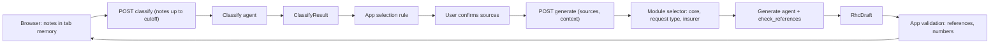

# RHC generation agent

Status: draft · Updated: 2026-11-06

## Problem
Sienes staff write each RHC by hand from a long Medexis history. The app must produce a faithful draft with references and alerts, never inventing clinical facts, and the wording and portal rules per insurer and request type will keep changing after the pilot. One large prompt would be hard to maintain and audit.

## Solution
Two agent runs per case, both on the Vercel AI SDK agent loop. **Classify** labels every note up to the cutoff with its kind (report, progress note, administrative note), specialty, date and ambiguity flags; the app then applies the selection rule and the user confirms the sources. **Generate** writes the RHC sections, portal fields, references and alerts from the confirmed sources, with a system prompt assembled from prompt modules chosen by the app. Its one tool, `check_references`, verifies every citation against the sources it was given. Both outputs are Zod-validated; the app re-validates references and numeric consistency before showing the draft.

## Decisions
- Vercel AI SDK `ToolLoopAgent` with provider instances, SDK retries off, `abortSignal` cancellation, no bare-string model ids (ADR-0001).
- Two separate runs with human review between them; no call per specialty and no chunking of the history (master doc, Implementation details).
- Sources are selected by app code, not by the model: latest report per specialty plus the latest later progress note, up to the cutoff; administrative notes never count. The selected sources go in the prompt.
- Prompt modules: `core` + `request/<admission|renewal>` + `insurer/<pami|osde|swiss-medical|union-personal|ostvla>`; specialty modules only when examples show different wording. Module versions are recorded in telemetry with the model id.
- Only tool in v1: `check_references`, in-process and read-only. Validation also runs in app code after the call, so a model that skips the tool still cannot ship a dangling reference.
- Contracts: `Note`, `ClassifyResult`, `RhcDraft` and telemetry schemas are shared by parser, UI and server; the AI-bound payload excludes administrative identity.
- Provider: OpenAI first (`gpt-6-luna` candidate) through `@ai-sdk/openai`; `@ai-sdk/anthropic` as the second instance for evaluation. Retention flags pass through `providerOptions` and are verified on the wire before real data (ADR-0002).

## Rejected
- `get_notes` / `get_rules` tools: the app already holds every note and composes the modules; model-driven fetching adds nondeterminism for no gain.
- Platform Agent Skills (OpenAI, Anthropic): require hosted containers, which the non-persistence rule forbids.
- OpenAI Agents SDK: OpenAI-first, tracing exported by default; see ADR-0001.

## Diagram

## Slices
1. [ ] Contracts and one synthetic case fixture (header, reports, progress notes, administrative notes). Verify: Vitest parses the fixture with the schemas and rejects a draft whose reference points at no source.
2. [ ] Classify run end to end with the AI SDK mock model, from route handler to a screen listing notes by kind and specialty. Verify: Playwright on the fixture shows the labels; a unit test asserts report vs progress note labels from the mock output.
3. [ ] Selection rule and sources screen for admission and renewal, with ambiguity alerts. Verify: unit tests for undated note, administrative note not used as baseline, later note contradicting a report, inclusive cutoff.
4. [ ] Generate run with mock model, prompt modules and `check_references`; draft with references and alerts shown in the UI. Verify: test that each (request type, insurer) pair selects the expected modules and records their versions; a dangling reference becomes an alert, never a silent draft.
5. [ ] Real provider in the development environment on the synthetic fixture: 120 s timeout per attempt, one browser-driven retry, cancellation, telemetry with model and module versions. Verify: integration test; a cancelled attempt's late response is discarded.
6. [ ] Evaluation on local real exports in the authorized environment: fidelity, specialty coverage, corrections, latency, cost; model chosen. Verify: rubric completed for the available cases; CI contains no clinical content.

## Out of scope
- OCR, external tools, sessions or memory, OME issuance, portal automation.
- Per-specialty prompt modules until an example shows the need.

## Open questions
- Insurer modules for OSDE, Swiss Medical, Unión Personal and OSTVLA: forms pending; assumption is the common structure with PAMI's verified fields only.
- Histories above the token budget: assumption is rejection with a message asking for a shorter export, per the master doc; a chunking strategy would need its own evaluation.
- Production model and retention compliance: pending the evaluation in slice 6 and the account checks in ADR-0002.
